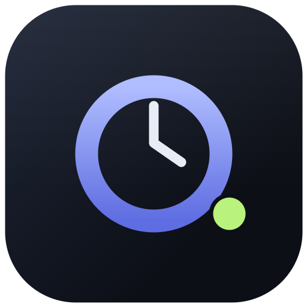

# BTR-Ollama

**A desktop client for [Ollama](https://ollama.com) that shows what the model is actually doing.**

[](LICENSE)
[](#install)
[](https://ollama.com/download)

BTR-Ollama is a native Electron app, not another localhost page in a browser tab. It pairs streaming chat with live token, context and sampling telemetry, and adds a coding agent that can work in a real project folder — with approvals in front of every write and command.

Everything runs against the Ollama instance you choose. Prompts, conversations and project files never go to a hosted model provider.



## Contents

- [Highlights](#highlights)
- [Requirements](#requirements)
- [Install](#install)
- [Run from source](#run-from-source)
- [First run](#first-run)
- [Models: search and one-click install](#models-search-and-one-click-install)
- [Chat that shows its work](#chat-that-shows-its-work)
- [Coding agent](#coding-agent)
- [Keyboard shortcuts](#keyboard-shortcuts)
- [Data and privacy](#data-and-privacy)
- [How it works](#how-it-works)
- [Build a desktop installer](#build-a-desktop-installer)
- [Project layout](#project-layout)
- [Contributing](#contributing)
- [License](#license)

## Highlights

- **Streaming chat** with any installed Ollama model, including reasoning models — `thinking` output is captured separately from the answer.
- **One-click model installs** — search ollama.com or Hugging Face, press **Install**, and watch live progress with a cancel button. No terminal needed.
- **Real telemetry** — prompt and completion tokens, tokens per second, time to first token, prompt-eval, decode, model load and total duration for every response.
- **A context gauge you can trust** — measured prompt + completion tokens against `num_ctx`, labelled **measured** or **estimate** so you always know which numbers came from the server.
- **A coding agent for real projects** — inspect, search, create and edit files, install packages, run tests, and commit, with per-action approval.
- **Sampling controls** — temperature, `top_p`, `top_k`, `repeat_penalty`, seed, `num_ctx`, `num_predict`, stop sequences and tri-state thinking.
- **Two considered themes** — ink-violet dark and warm-paper light, plus a System option that follows the OS.
- **Smooth by design** — streamed text is batched to animation frames, counters animate, and numeric displays use tabular figures so they do not jitter.

## Requirements

- [Ollama](https://ollama.com/download) running locally. The daemon usually starts with the app; otherwise run `ollama serve`.
- Node.js 20+ **only to build from source**. The packaged app does not need Node.
- Linux: [bubblewrap](https://github.com/containers/bubblewrap) is optional and automatically used for coding-agent commands when available.

## Install

Grab the latest build from [Releases](../../releases).

**Linux**

```bash
chmod +x BTR-Ollama-1.0.0.AppImage
./BTR-Ollama-1.0.0.AppImage
```

On systems without FUSE, run the AppImage with `--appimage-extract-and-run`, or install the `.deb` instead.

**macOS and Windows**

Build a `.dmg` or `.nsis` installer from source with `npm run dist` on that platform. Prebuilt installers are published on the Releases page when available.

## Run from source

```bash
npm install
npm run dev        # Vite + Electron with hot reload
```

Production-style launch against the built renderer:

```bash
npm run build
npm start
```

## First run

The introduction screen appears once. **Enter workspace** (or `Esc`) opens the app, and later launches go straight to the workspace.

BTR-Ollama connects to `http://127.0.0.1:11434` by default. If Ollama lives elsewhere, open **Settings** (`Ctrl/Cmd + ,`) and change the base URL. The connection chip in the sidebar turns green when the daemon answers.

Use the sun/moon button beside the connection chip to swap themes. **Settings → Appearance** also offers System, Dark and Light, and the choice is saved with the rest of your settings.

## Models: search and one-click install

Open the model picker in the header and choose the **Online** tab. Search the Ollama library or Hugging Face's GGUF models, then press **Install**:

- The model downloads through your local Ollama daemon. The row shows the current status, downloaded and total size, a percentage bar, and a **Cancel** button.
- When the pull finishes, the row reads **Installed**, the installed list refreshes, and the model is ready to select.
- Ollama results pull by library name; Hugging Face results pull as `hf.co/<repo>`.
- Only one install runs at a time. A failed install shows the reason inline with **Retry**.
- Results also link to their model page, and the copy button gives you the equivalent `ollama pull` or `ollama run hf.co/...` command.

Search and downloads need an internet connection and a running Ollama daemon. The **Installed** tab lists everything already on the host.

## Chat that shows its work

Pick a model from the header and start typing. Each conversation keeps its own system prompt, sampling parameters and thinking mode.

The inspector on the right holds the detail:

| Section | What it shows |
| --- | --- |
| System prompt | Editable prompt for this conversation, presets, token estimate |
| Context | Tokens used vs `num_ctx`, measured or estimated, clear-context action |
| Sampling | Every generation parameter, applied to the next request |
| Model | `/api/show` metadata: family, architecture, parameters, quantization, context, embedding size, disk size |
| Usage | Prompt/completion totals, average decode speed, sparkline, last-request timings |

Conversation tools include search, rename, delete, Markdown export with metadata and per-message stats, and context clearing that keeps your system prompt. A preset library covers general assistant, senior engineer, code reviewer, technical writer, analyst, tutor and token-efficient prompts.

Token counts and timings come from the final chunk Ollama returns (`prompt_eval_count`, `eval_count`, `eval_duration`, `total_duration`, `load_duration`, `prompt_eval_duration`). Before the first measured request, values are marked **estimate** and use a small content-length heuristic. Time to first token is measured by the app between the request and the first received chunk.

## Coding agent

Switch to **Code** in the sidebar, choose **New coding task**, select a project folder, and link a model with the `tools` capability (for example `qwen2.5-coder:7b`).

The agent opens by asking clarifying questions and waits for your answer. Reads and searches run immediately; file edits pause for **Allow once** or **Deny**. Shell commands ask by default, and the **Commands ask first** switch in the composer changes them to **Commands auto-run** for that session. The first command approval also offers **Always allow** so later commands in the session run without a prompt.

Sessions, project paths, command policy and the linked model are saved locally.

| Tool | Access | What it does |
| --- | --- | --- |
| `ask_user` | pauses for you | Asks one to three clarifying questions and waits before continuing |
| `list_files` | automatic | Lists project files while skipping dependencies, build output and VCS directories |
| `read_file` | automatic | Reads a bounded line range from a text file |
| `search_files` | automatic | Searches file contents by literal text or regular expression |
| `git_diff` | automatic | Shows git status and the uncommitted diff |
| `write_file` | approval | Creates or replaces a file, including nested project folders |
| `replace_in_file` | approval | Replaces an exact block in a file |
| `run_command` | approval or auto-run | Runs a shell command in the project for installs, tests, builds, formatting and commits |

Every path is resolved and checked against the selected project root. Symlinks cannot escape it, `.git` and dependency directories are skipped, and sensitive `.env` files are excluded from listings and searches. Commands start in the project folder; on Linux, bubblewrap keeps the rest of the filesystem read-only and mounts only the project writable when available. Commands time out after 180 seconds by default (600 maximum), and failures return their output, stderr and exit code to the model so it can fix the cause.

## Keyboard shortcuts

| Shortcut | Action |
| --- | --- |
| `Enter` | Send (configurable in Settings) |
| `Shift + Enter` | New line |
| `Ctrl/Cmd + Enter` | Send regardless of the Enter setting |
| `Ctrl/Cmd + N` | New chat |
| `Ctrl/Cmd + ,` | Settings |
| `Ctrl/Cmd + Shift + +` | Zoom in |
| `Ctrl/Cmd + Shift + -` | Zoom out |
| `Ctrl/Cmd + Shift + 0` | Reset zoom to 100% |
| `Esc` | Close dialogs and popovers |

## Data and privacy

Conversations, coding sessions and settings are written atomically to `btr-ollama-store.json` in Electron's per-user data directory:

| Platform | Location |
| --- | --- |
| Linux | `~/.config/BTR-Ollama` |
| macOS | `~/Library/Application Support/BTR-Ollama` |
| Windows | `%APPDATA%/BTR-Ollama` |

Prompts and project files are sent only to the Ollama base URL you configure. The only other network requests are model searches to `ollama.com` and `huggingface.co`, plus the model download your Ollama daemon performs on your behalf. There is no analytics, telemetry or account system.

## How it works

- `electron/main.cjs` owns all network access. It calls Ollama's REST API (`/api/tags`, `/api/version`, `/api/show`, `/api/chat`, `/api/pull`), parses NDJSON streams and forwards typed events to the renderer over IPC. Online model search and installs run here too, so no CORS configuration is required.
- `electron/preload.cjs` exposes a narrow `window.btr` bridge. The renderer runs with `contextIsolation` on, `nodeIntegration` off and sandboxing enabled.
- `src/` is React + TypeScript. Streaming events accumulate in a ref and flush on `requestAnimationFrame`, keeping long responses smooth.
- The coding agent uses Ollama's non-streaming tool-calling API. The renderer drives the tool loop and asks for approval or a clarification answer; the main process validates every path against the project root and executes a tool only after the renderer sends an approved call.

## Build a desktop installer

```bash
npm run dist:linux   # AppImage + .deb
npm run dist         # current platform: dmg on macOS, NSIS on Windows
```

Output goes to `release/`. On Linux the AppImage is a single executable file.

## Project layout

```
electron/        main process (Ollama client, streaming, storage, tools) + preload bridge
src/             React renderer
  components/    sidebar, header, transcript, composer, picker, inspector, intro, dialogs
  hooks/         animated number counter
  lib/           defaults, agent tools and prompts, theme, formatting, presets, export
build/           app icon and packaging resources
```

## Contributing

Issues and pull requests are welcome. For a change to the app, run `npm run build` before opening a pull request and describe what you tested. Keep changes focused; the app deliberately avoids extra dependencies.

## License

[MIT](LICENSE)
